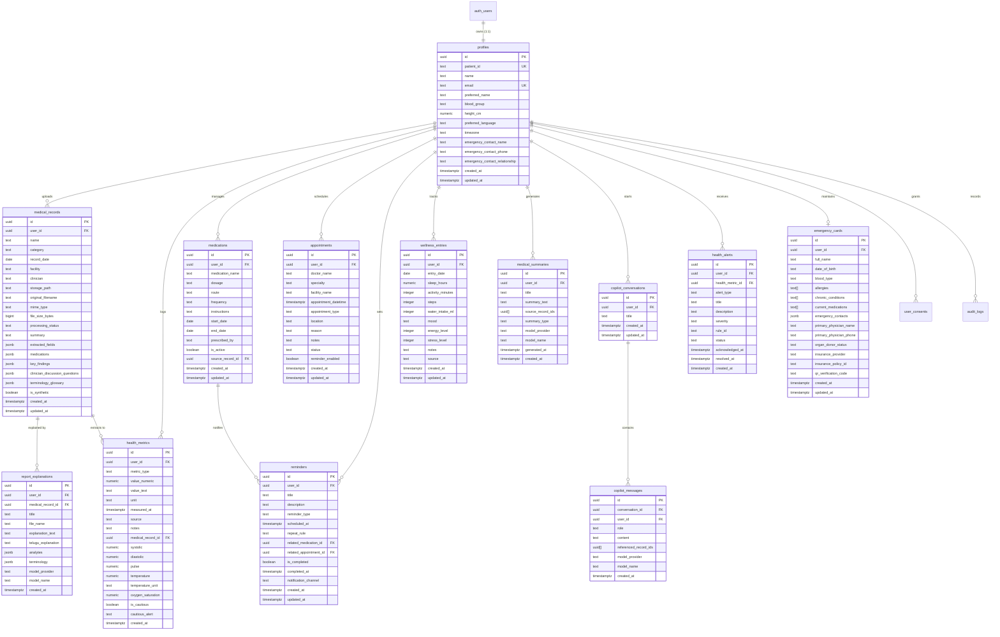

# HealthTwin AI — Personal Digital Twin & AI Health Copilot

> **Empowering patients with structured personal health timelines, clinical diagnostic report understanding, medicine tracking, and clinically bounded AI health assistance — backed by Supabase PostgreSQL.**

---

## 1. Project Overview & System Philosophy

**HealthTwin AI** is a personal digital health twin and healthcare copilot platform engineered for hackathons and production deployment. It allows individuals to securely store medical records, track longitudinal health metrics (blood pressure, glucose, temperature, pulse, SpO2), manage medications and appointments, translate complex clinical laboratory reports into patient-understandable language (including bilingual English and Telugu summaries), and consult an AI copilot grounded exclusively in verified patient documents.

### Ethical & Clinical Safety Principles:
1. **Zero Hallucination / Strict Grounding**: The AI Health Copilot answers inquiries strictly from uploaded diagnostic records, explicit patient metrics, or verified clinical references.
2. **Clinical Safety Boundary**: Direct prescription requests, dosage change questions, or drug recommendations are automatically intercepted with safety guardrails that instruct the user to consult their licensed clinician or pharmacist.
3. **No Diagnostic Pretenses**: Visual metrics and trend monitors never label a user with a medical condition based merely on an automated threshold.
4. **Zero Fallback Compromise**: When database credentials are not configured, the backend returns clear `HTTP 503` service unavailable errors rather than silently storing sensitive personal health records in temporary volatile memory.

---

## 2. Technology Stack

- **Frontend**: React 18, Vite, TypeScript, Tailwind CSS, Lucide Icons
- **Backend**: Node.js, Express, TypeScript (ESM modules), TSX
- **Database**: Supabase PostgreSQL with Row Level Security (RLS)
- **Authentication**: Supabase Auth / Cryptographically signed JWT tokens with RFC 4122 UUID identity mapping
- **File Storage**: Private Supabase Storage bucket (`medical-records`) with signed temporary URLs
- **AI Integration**: Provider-independent server-side AI adapter supporting OpenAI/Anthropic/custom endpoints with 100% grounded fallback synthesis
- **Testing**: Native HTTP and TypeScript test runner (`npm run test`)

---

## 3. Database Architecture & ER Diagram

The database is built on **Supabase PostgreSQL** and version-controlled via [`supabase/migrations/001_initial_schema.sql`](file:///c:/Users/srini/OneDrive/Desktop/AI%20WITH%20HEALTHCARE/supabase/migrations/001_initial_schema.sql).

### Entity Relationship (ER) Diagram



### Table Summary & Responsibilities:
1. **`profiles`**: User identity, demographics, blood type, preferences, emergency contact.
2. **`medical_records`**: Diagnostic lab reports, imaging, doctor notes with structured extracts and private storage path.
3. **`health_metrics`**: Numeric physiological metrics over time (blood pressure, heart rate, temperature, glucose, SpO2).
4. **`medications`**: Active and historical prescribed therapies with dosages and schedules.
5. **`appointments`**: Clinical visits and specialist consultations with timezone support.
6. **`reminders`**: Medication adherence alarms, hydration checks, and routine health follow-ups.
7. **`medical_summaries`**: AI synthesized longitudinal health reviews citing source diagnostic reports.
8. **`copilot_conversations`**: Multi-turn dialogue sessions for the patient health copilot.
9. **`copilot_messages`**: Chat messages with patient grounding context and model attribution.
10. **`wellness_entries`**: Daily lifestyle metrics (sleep, hydration, activity, mood, energy).
11. **`health_alerts`**: Rule-based notifications for unusual readings with acknowledge/resolve tracking.
12. **`report_explanations`**: Bilingual plain-language explanations (English & Telugu) for lab reports.
13. **`emergency_cards`**: Critical medical summary for first responders (blood type, allergies, medications, contacts).
14. **`user_consents`**: Privacy consent tracking and versioning.
15. **`audit_logs`**: Security telemetry recording authenticated operations without logging sensitive PHI.

---

## 4. API Endpoints Catalog

All protected endpoints require an `Authorization: Bearer <token>` header.

### Health & Authentication
| Method | Endpoint | Description | Auth Required |
|---|---|---|---|
| `GET` | `/api/health` | Service status, database connectivity & telemetry | No |
| `POST` | `/api/auth/register` | Register a new patient account | No |
| `POST` | `/api/auth/login` | Authenticate and obtain JWT token | No |
| `GET` | `/api/auth/me` | Fetch authenticated subject identity | Yes |
| `GET` | `/api/profile` | Retrieve personal digital twin profile | Yes |
| `PATCH` | `/api/profile` | Update profile demographics or preferences | Yes |

### Medical Records & Documents
| Method | Endpoint | Description | Auth Required |
|---|---|---|---|
| `GET` | `/api/records` | List medical records for authenticated patient | Yes |
| `POST` | `/api/records` | Create record entry with metadata | Yes |
| `GET` | `/api/records/:id` | Get record details by ID | Yes |
| `PATCH` | `/api/records/:id` | Update record metadata | Yes |
| `DELETE` | `/api/records/:id` | Delete record and associated file | Yes |
| `GET` | `/api/records/:id/file-url` | Generate temporary signed URL for private storage file | Yes |

### Health Metrics & Vitals
| Method | Endpoint | Description | Auth Required |
|---|---|---|---|
| `GET` | `/api/metrics` | Retrieve all health observations (filter by `?type=`) | Yes |
| `POST` | `/api/metrics` | Log a new metric observation | Yes |
| `GET` | `/api/metrics/:id` | Retrieve metric observation by ID | Yes |
| `PATCH` | `/api/metrics/:id` | Update recorded observation | Yes |
| `DELETE` | `/api/metrics/:id` | Remove metric observation | Yes |
| `GET` | `/api/vitals` | Compatibility endpoint for vitals dashboard | Yes |
| `POST` | `/api/vitals` | Log vitals measurement (BP, pulse, temp, SpO2) | Yes |

### Medications & Reminders
| Method | Endpoint | Description | Auth Required |
|---|---|---|---|
| `GET` | `/api/medications` | List current and historical medications | Yes |
| `POST` | `/api/medications` | Add prescribed medication with dosage | Yes |
| `PATCH` | `/api/medications/:id` | Update medication schedule or active status | Yes |
| `DELETE` | `/api/medications/:id` | Remove medication entry | Yes |
| `GET` | `/api/reminders` | List reminders and medicine alarms | Yes |
| `POST` | `/api/reminders` | Create reminder | Yes |
| `PATCH` | `/api/reminders/:id` | Edit reminder | Yes |
| `DELETE` | `/api/reminders/:id` | Delete reminder | Yes |
| `POST` | `/api/reminders/:id/complete` | Mark reminder as completed / taken | Yes |

### Appointments & Wellness
| Method | Endpoint | Description | Auth Required |
|---|---|---|---|
| `GET` | `/api/appointments` | Get appointments (filter by `?filter=upcoming`) | Yes |
| `POST` | `/api/appointments` | Schedule clinical appointment | Yes |
| `PATCH` | `/api/appointments/:id` | Reschedule or edit appointment | Yes |
| `DELETE` | `/api/appointments/:id` | Cancel appointment | Yes |
| `GET` | `/api/wellness` | List daily wellness logs | Yes |
| `POST` | `/api/wellness` | Log daily sleep, hydration, and steps | Yes |
| `PATCH` | `/api/wellness/:id` | Update wellness entry | Yes |
| `DELETE` | `/api/wellness/:id` | Delete wellness entry | Yes |

### AI Summary & Health Copilot
| Method | Endpoint | Description | Auth Required |
|---|---|---|---|
| `GET` | `/api/summary` | Get synthesized digital twin summary | Yes |
| `POST` | `/api/summary/generate` | Generate fresh summary using AI provider | Yes |
| `GET` | `/api/timeline` | Get unified chronological health timeline | Yes |
| `GET` | `/api/copilot/conversations` | List user's copilot chat sessions | Yes |
| `POST` | `/api/copilot/conversations` | Start new conversation session | Yes |
| `DELETE` | `/api/copilot/conversations/:id`| Delete chat session | Yes |
| `GET` | `/api/copilot/conversations/:id/messages` | Get chat messages | Yes |
| `POST` | `/api/copilot/conversations/:id/messages` | Send message and receive grounded AI answer | Yes |
| `POST` | `/api/copilot/query` | Direct query endpoint (backward compatible) | Yes |

### Diagnostic Report Explainer, Alerts & Emergency Card
| Method | Endpoint | Description | Auth Required |
|---|---|---|---|
| `POST` | `/api/reports/:id/explain` | Generate plain-language bilingual explanation | Yes |
| `GET` | `/api/reports/:id/explanations` | Get saved explanations for report | Yes |
| `GET` | `/api/alerts` | List health alert flags | Yes |
| `POST` | `/api/alerts/:id/acknowledge` | Acknowledge alert | Yes |
| `POST` | `/api/alerts/:id/resolve` | Mark alert as clinically resolved | Yes |
| `GET` | `/api/emergency-card` | Get emergency health card details | Yes |
| `PATCH` | `/api/emergency-card` | Update emergency card information | Yes |

---

## 5. Local Setup & Execution Guide

### Prerequisites
- **Node.js** v18+ or v20+ installed
- Windows PowerShell, macOS Terminal, or Linux Bash

### Step 1: Install Dependencies
```bash
# Install root, backend, and frontend dependencies
npm install --prefix backend
npm install --prefix frontend
```

### Step 2: Configure Environment Variables

1. **Frontend Configuration (`frontend/.env`)**:
```env
VITE_SUPABASE_URL=https://zeyuqvzqtbqwpumzvjxv.supabase.co
# Copy from Supabase Dashboard (Settings > API > Project API Keys > anon public)
VITE_SUPABASE_ANON_KEY=<your_supabase_anon_public_key>
VITE_API_URL=http://localhost:5000/api
```

2. **Backend Configuration (`backend/.env`)**:
```env
PORT=5000
NODE_ENV=development
CORS_ORIGIN=http://localhost:5173
JWT_SECRET=healthtwin_super_secret_jwt_key_2026_dev

# Supabase Project Configuration
SUPABASE_URL=https://zeyuqvzqtbqwpumzvjxv.supabase.co
SUPABASE_SERVICE_ROLE_KEY=<your_supabase_service_role_secret_key>

# Optional AI Provider Configuration
AI_PROVIDER_API_KEY=
AI_PROVIDER_MODEL=gpt-4o-mini
AI_PROVIDER_BASE_URL=https://api.openai.com/v1
```

> **Security Note**: Never commit `backend/.env` to Git. The service role key must remain strictly on the backend.

### Step 3: Run Database Migration in Supabase

1. Open your Supabase Dashboard: [https://supabase.com/dashboard/project/zeyuqvzqtbqwpumzvjxv](https://supabase.com/dashboard/project/zeyuqvzqtbqwpumzvjxv)
2. In the left navigation, click **SQL Editor**.
3. Open the file [`supabase/migrations/001_initial_schema.sql`](file:///c:/Users/srini/OneDrive/Desktop/AI%20WITH%20HEALTHCARE/supabase/migrations/001_initial_schema.sql) in this repository.
4. Copy the entire contents of `001_initial_schema.sql` into the Supabase SQL Editor and click **Run**.
5. The migration automatically:
   - Creates all 15 relational tables with constraints and indexes.
   - Attaches `updated_at` automatic timestamp triggers.
   - Configures Row Level Security (RLS) policies for user data isolation.
   - Creates the private storage bucket `medical-records` with access policies.
   - Inserts the initial synthetic demonstration profile (`Alex Morgan`, UUID: `d3b07384-d113-469a-a8fe-89241951f38e`).

### Step 4: Verify Database Connection

Run the automated verification script:
```bash
npm run verify-db
```
The script will probe your Supabase PostgreSQL database, test table readiness, and run synthetic record CRUD operations.

### Step 5: Start Development Servers

Run backend and frontend:
```bash
# Terminal 1 - Backend API (Port 5000)
npm run dev:backend

# Terminal 2 - Frontend App (Port 5173)
npm run dev:frontend
```
Open [http://localhost:5173](http://localhost:5173) in your browser.

---

## 6. Running Tests & Quality Verification

Run the automated test suite verifying all 21 test scenarios:
```bash
npm run test
```

### Verified Test Scenarios:
- **API Discovery**: `GET /api/health` and `GET /` documentation ping.
- **Authentication Guardrails**: Rejecting requests without tokens or with forged tokens with `HTTP 401`.
- **Identity Derivation**: Decoding cryptographically signed JWT tokens and resolving UUIDs.
- **Clinical Safety Guardrails**: AI Copilot refusing direct prescription requests and advising clinician consult.
- **Document Grounding**: Grounded answers citing source diagnostic documents.
- **Input Validation**: Rejecting empty records, missing metric types, and malformed reminder payloads with `HTTP 400`.
- **Database Degradation Integrity**: Returning `HTTP 503` when database credentials are not configured, without silent in-memory fallback.

---

## 7. Production Deployment Guide

### Deploying the Frontend (Vercel / Netlify / Cloudflare Pages)
1. Set the Root Directory to `frontend`.
2. Build Command: `npm run build`
3. Output Directory: `dist`
4. Environment Variables:
   - `VITE_API_URL`: URL of your deployed backend (e.g. `https://api.healthtwin.app/api`)
   - `VITE_SUPABASE_URL`: `https://zeyuqvzqtbqwpumzvjxv.supabase.co`
   - `VITE_SUPABASE_ANON_KEY`: Your project's `anon public` key (from Supabase Dashboard API settings)

### Deploying the Backend (Render / Railway / Fly.io / AWS ECS)
1. Set the Root Directory to `backend`.
2. Build Command: `npm run build`
3. Start Command: `npm start`
4. Set Environment Variables:
   - `NODE_ENV`: `production`
   - `PORT`: (Provided by hosting platform, defaults to 5000)
   - `CORS_ORIGIN`: URL of your deployed frontend (e.g. `https://healthtwin.vercel.app`)
   - `SUPABASE_URL`: `https://zeyuqvzqtbqwpumzvjxv.supabase.co`
   - `SUPABASE_SERVICE_ROLE_KEY`: Your private Supabase service role key.
   - `JWT_SECRET`: A high-entropy random secret key.

---

## 8. Troubleshooting

| Issue | Cause | Resolution |
|---|---|---|
| `GET /api/records` returns `503 Service Unavailable` | `SUPABASE_SERVICE_ROLE_KEY` is not set in `backend/.env`. | Go to Supabase Project Settings -> API, copy the `service_role` secret key, and paste it into `backend/.env`. |
| `POST /api/records` returns `401 Unauthorized` | Request is missing `Authorization: Bearer <token>`. | Log in via `/api/auth/login` to obtain a token, or ensure the frontend has logged in. |
| Verification fails with `relation "profiles" does not exist` | SQL migration has not been executed yet. | Copy `supabase/migrations/001_initial_schema.sql` into the Supabase SQL Editor and run it. |
| Vite reports CORS error in console | Backend does not have frontend origin listed. | Update `CORS_ORIGIN` in `backend/.env` to match your frontend URL. |
